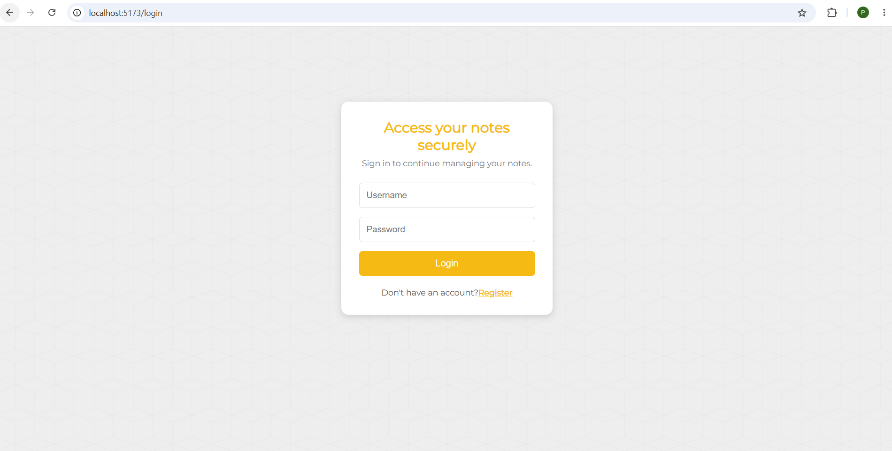
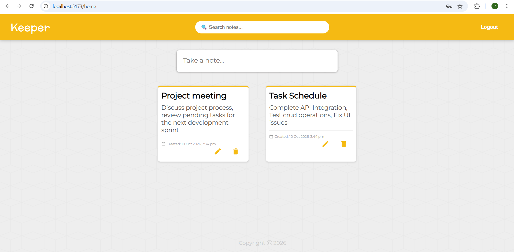
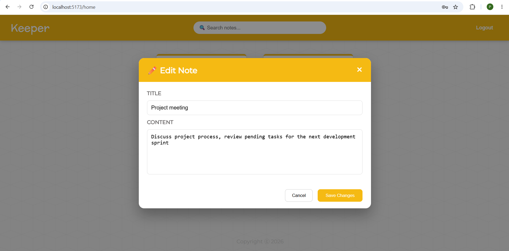

# Keeper – Full Stack Notes Management Application

Keeper is a full-stack web application that allows users to create, manage, edit, delete, and search their personal notes. It uses React for the frontend and Django REST Framework for the backend, with JWT authentication to protect user accounts and notes.

## Screenshots

### Login Page


### Notes Dashboard


### Edit Note


## Features

- User registration and login
- JWT-based authentication
- Automatic access token refresh
- Protected routes
- Create, view, edit, and delete notes
- Search notes
- Display note creation and last-updated timestamps
- User-specific notes management
- Success and error notifications

## Technologies Used

### Frontend
- React.js
- JavaScript (ES6+)
- Material UI
- React Router
- React Toastify
- CSS

### Backend
- Python
- Django
- Django REST Framework
- Django REST Framework Simple JWT
- Django CORS Headers
- SQLite

## How Authentication Works

1. The user logs in and receives an access token and a refresh token, which are stored in `localStorage`.
2. Every API request is sent with the access token in the `Authorization: Bearer` header.
3. If the server returns `401 Unauthorized`, the app sends the refresh token to `/api/token/refresh/`.
4. If the refresh token is valid, the new access token is saved and the original request is retried automatically.
5. If the refresh request fails, both tokens are cleared and the user is redirected to the login page.

## Project Structure

```text
Keeper/
│
├── Backend/
│   ├── config/
│   ├── notesapp/
│   ├── manage.py
│   ├── requirements.txt
│   └── .env.example
│
├── Frontend/
│   ├── public/
│   ├── src/
│   ├── package.json
│   └── index.html
│
├── .gitignore
└── README.md
```

## Installation and Setup

### 1. Clone the Repository

```bash
git clone <your-github-repository-url>
cd Keeper
```

### 2. Backend Setup

```bash
cd Backend
python -m venv env
```

Activate the virtual environment:

```bash
# Windows
env\Scripts\activate

# Mac/Linux
source env/bin/activate
```

Install the required packages:

```bash
pip install -r requirements.txt
```

Create a `.env` file in the Backend folder using `.env.example` as a reference:

```env
DJANGO_SECRET_KEY=your_generated_secret_key
DEBUG=True
```

Run migrations and start the server:

```bash
python manage.py migrate
python manage.py runserver
```

Backend runs at `http://127.0.0.1:8000/`

### 3. Frontend Setup

Open another terminal:

```bash
cd Frontend
npm install
npm run dev
```

Open the frontend URL shown in your terminal.

## Database

SQLite is used as the development database. Django ORM handles database operations.

## Future Improvements

- Deploy the application online
- Add note-formatting options
- Store tokens in HttpOnly cookies for stronger security

## Author

**Pandimeenal A**
MCA Graduate | Full Stack Developer

- GitHub: https://github.com/Pandimeenal23
- LinkedIn: https://www.linkedin.com/in/pandimeenal23